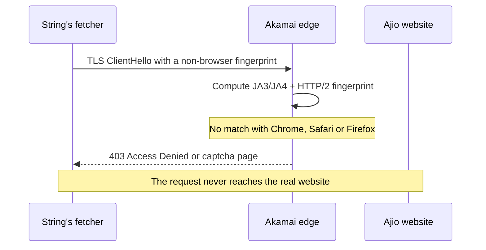
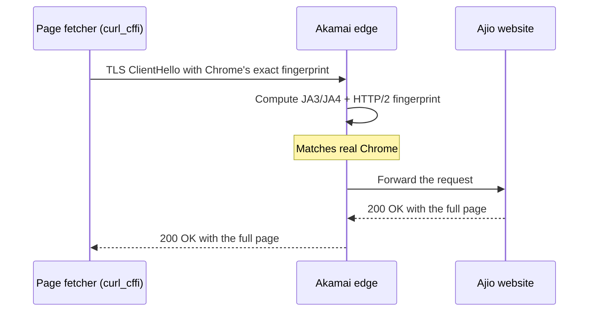
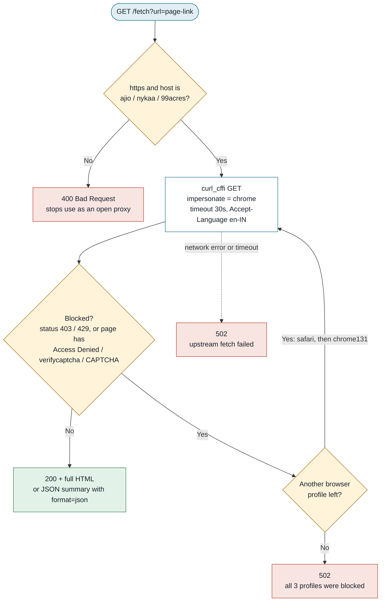
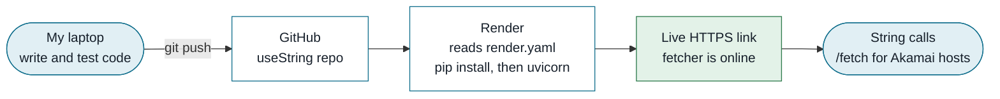

# Page Fetcher for String

Ajio, Nykaa and 99acres sit behind **Akamai Bot Manager**. Akamai blocks String's fetcher because its network "fingerprint" doesn't match a real browser.
This small service connects with the exact **TLS and HTTP/2 fingerprint of Chrome or Safari**, so Akamai treats it like a normal shopper and lets the request through to the full page.

---

## 1. Where String fails today


### Why Akamai catches it

Akamai doesn't only look at *what* you ask for (the URL and headers). It looks at *how* your client connects, before a single byte of the page is sent.

| What Akamai checks | Real Chrome | Typical script (Python `requests`, plain HTTP clients) |
|---|---|---|
| **TLS fingerprint** (JA3 / JA4): the cipher suites, extensions, their order, curves and ALPN in the TLS `ClientHello` | Chrome's exact list, from BoringSSL | OpenSSL's default list, which no browser sends |
| **HTTP/2 fingerprint**: the `SETTINGS` values, window size, priority and pseudo-header order | Chrome's exact values | Often HTTP/1.1 only, or different values |
| **Headers**: which ones, in what order | Browser order | Library order |

If these don't match a known browser, Akamai answers with `403 Access Denied`, a `429`, or a captcha page. A plain Python request to these sites gets a `403` straight away. Changing the `User-Agent` header doesn't help, because the TLS handshake still gives the client away.



---

## 2. How my fix works

The service uses [`curl_cffi`](https://github.com/lexiforest/curl_cffi), Python bindings for **curl-impersonate**. It is curl built with BoringSSL and tuned so its TLS `ClientHello` and HTTP/2 frames are byte-for-byte the same as a real browser's. To Akamai, the connection looks identical to a person opening the page in Chrome.



If Akamai still challenges one browser profile, the service switches to the next one:



Block detection looks at the status code and searches the first 20 KB of the page for Akamai's block markers (`Access Denied`, `verifycaptcha`, `data-label="CAPTCHA"`). So a "200 OK" that is really a captcha page is still counted as blocked.

| Before | After |
|---|---|
| String's fetcher sends a non-browser TLS fingerprint. Akamai returns 403 or a captcha. Ajio takes about 1.5 minutes just to fail. | The page fetcher sends Chrome's real TLS + HTTP/2 fingerprint. Akamai lets it through and the site returns the full page. |

---

## 3. How it plugs into String

String keeps its normal pipeline. It adds one routing rule: Akamai-protected hosts go to the page fetcher, and the HTML comes back into String's usual markdown step.


**Why route these hosts straight to the fetcher?** String's normal fetcher will fail on them anyway, and on Ajio that takes about 1.5 minutes. Routing by host skips that wait. The dotted line is an optional safety net: if any other site comes back 403 or captcha, String can retry it through the fetcher.

The change on String's side (simplified):

```python
AKAMAI_HOSTS = {"www.ajio.com", "www.nykaa.com", "www.99acres.com"}

if urlparse(url).hostname in AKAMAI_HOSTS:
    r = httpx.get(f"{FETCHER_URL}/fetch", params={"url": url}, timeout=100)
    if r.status_code == 200:
        return to_markdown(r.text)   # String's existing converter
    # 502 means Akamai blocked every profile: surface it as a fetch error
```

---

## 4. How it's set up on GitHub



| File | What it does |
|---|---|
| `app.py` | The page fetcher: FastAPI app with the host allowlist, curl_cffi browser impersonation, block detection and profile fallback. |
| `get_request_ids.py` | Proof of the problem: sends Ajio and Nykaa links through String's `/v1/fetch` and prints the `request-id` / `trace-id` headers of the failures. |
| `render.yaml` | Render config: Python web service, Singapore region, free plan, `uvicorn app:app --host 0.0.0.0 --port $PORT`. |
| `requirements.txt` | `fastapi`, `uvicorn`, `curl_cffi` (the TLS / HTTP/2 impersonation). |

---

## API reference

`GET /fetch?url=<page>&format=html|json`

| Status | Meaning |
|---|---|
| `200` | Page fetched. Body is the raw HTML, or JSON with `format=json`. |
| `400` | URL is not `https`, or the host isn't on the allowlist. |
| `502` | Akamai blocked all 3 profiles, or the upstream request failed (network error or timeout). |

With `format=json` you get:

```json
{
  "url": "https://www.ajio.com/men-tshirts/c/830216014",
  "final_url": "https://www.ajio.com/men-tshirts/c/830216014",
  "status": 200,
  "profile": "chrome",
  "bytes": 512345,
  "ms": 1830,
  "blocked": false,
  "title": "Men T-Shirts ...",
  "html": "<!DOCTYPE html>..."
}
```

*(example values)* `profile` tells you which browser fingerprint got through. `ms` is how long that attempt took.

---

## My approach

1. **Reproduced the failure.** Sent real Ajio and Nykaa links through String's API with `get_request_ids.py` and saved each request ID, so String's team can trace the exact failed requests in their logs.
2. **Found the layer it fails at.** A plain Python request gets a `403` before any page logic runs, and changing headers doesn't fix it. That points to Akamai blocking on the TLS / HTTP/2 fingerprint, not on the URL or rate.
3. **Matched the fingerprint instead of fighting the check.** Used `curl_cffi` to send a real Chrome / Safari `ClientHello` and HTTP/2 settings. No headless browser, no captcha solving, so each request stays fast and light.
4. **Added fallbacks and honest failure.** Three impersonation profiles tried in order, a 30-second timeout per try, block detection on status codes and page content, and a clear `502` when every profile is blocked.
5. **Locked it down.** Only `https` URLs on the 3 Akamai hosts are accepted, so the service can't be used as an open proxy.
6. **Made it easy to plug in.** One HTTP endpoint that returns plain HTML, so String's existing markdown step works on it without changes.
7. **Deployed it.** Code on GitHub, running on Render from `render.yaml`.

---

## Run it yourself

```bash
pip install -r requirements.txt
uvicorn app:app --host 0.0.0.0 --port 8000
```

Then open:

```
http://localhost:8000/fetch?url=https://www.ajio.com/men-tshirts/c/830216014
http://localhost:8000/fetch?url=https://www.ajio.com/men-tshirts/c/830216014&format=json
```

## Known limits

- **JavaScript challenges:** if Akamai escalates to its JavaScript sensor check (the `_abck` cookie flow), a fingerprint alone can't pass it, because curl_cffi doesn't run JavaScript. The service detects this and returns `502` instead of bad data.
- **Fingerprints age:** Akamai updates its list of known browsers. Profiles may need bumping (for example `chrome131` to a newer Chrome) when `curl_cffi` releases new ones.
- **Free hosting:** Render's free plan sleeps when idle, so the first call after a break is slow. For real customer traffic, String would run this on its own servers.
