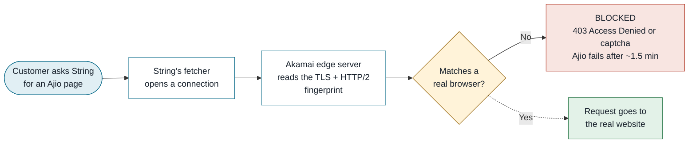
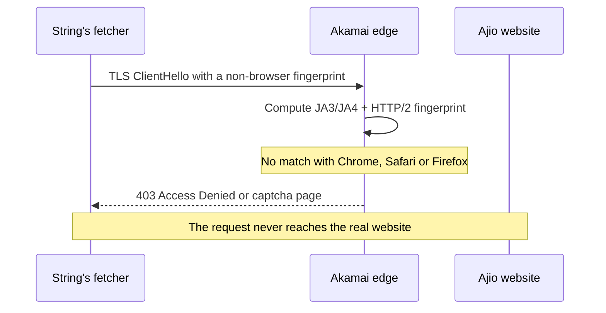
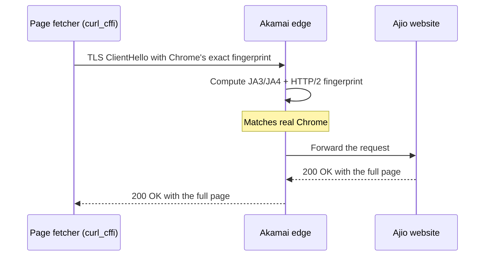
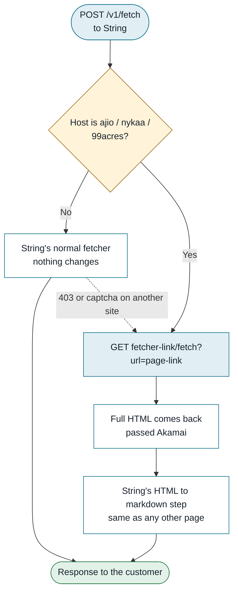
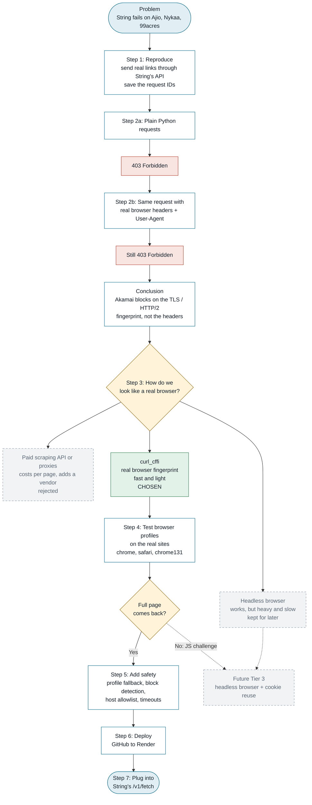
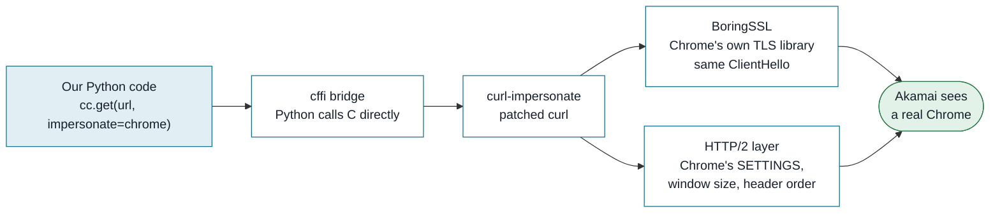
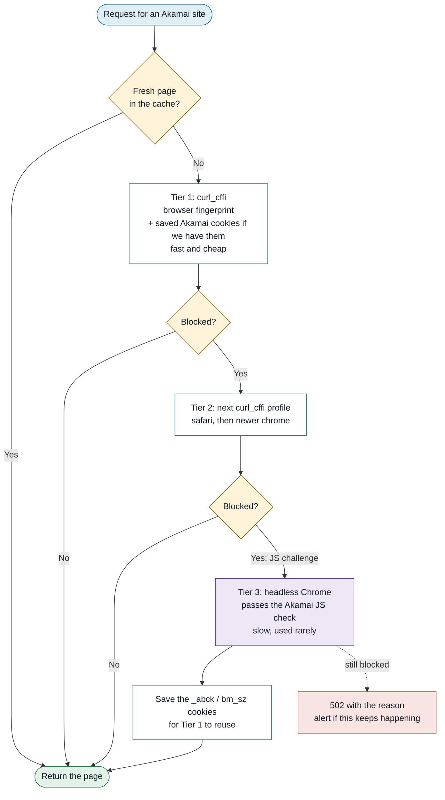
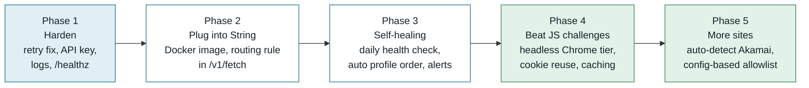

# Page Fetcher for String

Ajio, Nykaa and 99acres sit behind **Akamai Bot Manager**. Akamai blocks String's fetcher because its network "fingerprint" doesn't match a real browser.
This small service connects with the exact **TLS and HTTP/2 fingerprint of Chrome or Safari**, so Akamai treats it like a normal shopper and lets the request through to the full page.

---

## 1. Where String fails today



### Why Akamai catches it

Akamai doesn't only look at *what* you ask for (the URL and headers). It looks at *how* your client connects, before a single byte of the page is sent.

| What Akamai checks | Real Chrome | Typical script (Python `requests`, plain HTTP clients) |
|---|---|---|
| **TLS fingerprint** (JA3 / JA4): the cipher suites, extensions, their order, curves and ALPN in the TLS `ClientHello` | Chrome's exact list, from BoringSSL | OpenSSL's default list, which no browser sends |
| **HTTP/2 fingerprint**: the `SETTINGS` values, window size, priority and pseudo-header order | Chrome's exact values | Often HTTP/1.1 only, or different values |
| **Headers**: which ones, in what order | Browser order | Library order |

If these don't match a known browser, Akamai answers with `403 Access Denied`, a `429`, or a captcha page. A plain Python request to these sites gets a `403` straight away. Changing the `User-Agent` header doesn't help, because the TLS handshake still gives the client away.



---

## 2. How my fix works

The service uses [`curl_cffi`](https://github.com/lexiforest/curl_cffi), Python bindings for **curl-impersonate**. It is curl built with BoringSSL and tuned so its TLS `ClientHello` and HTTP/2 frames are byte-for-byte the same as a real browser's. To Akamai, the connection looks identical to a person opening the page in Chrome.



If Akamai still challenges one browser profile, the service switches to the next one:


Block detection looks at the status code and searches the first 20 KB of the page for Akamai's block markers (`Access Denied`, `verifycaptcha`, `data-label="CAPTCHA"`). So a "200 OK" that is really a captcha page is still counted as blocked.

| Before | After |
|---|---|
| String's fetcher sends a non-browser TLS fingerprint. Akamai returns 403 or a captcha. Ajio takes about 1.5 minutes just to fail. | The page fetcher sends Chrome's real TLS + HTTP/2 fingerprint. Akamai lets it through and the site returns the full page. |

---

## 3. How it plugs into String

String keeps its normal pipeline. It adds one routing rule: Akamai-protected hosts go to the page fetcher, and the HTML comes back into String's usual markdown step.



**Why route these hosts straight to the fetcher?** String's normal fetcher will fail on them anyway, and on Ajio that takes about 1.5 minutes. Routing by host skips that wait. The dotted line is an optional safety net: if any other site comes back 403 or captcha, String can retry it through the fetcher.

The change on String's side (simplified):

```python
AKAMAI_HOSTS = {"www.ajio.com", "www.nykaa.com", "www.99acres.com"}

if urlparse(url).hostname in AKAMAI_HOSTS:
    r = httpx.get(f"{FETCHER_URL}/fetch", params={"url": url}, timeout=100)
    if r.status_code == 200:
        return to_markdown(r.text)   # String's existing converter
    # 502 means Akamai blocked every profile: surface it as a fetch error
```

---

## 4. How it's set up on GitHub


| File | What it does |
|---|---|
| `app.py` | The page fetcher: FastAPI app with the host allowlist, curl_cffi browser impersonation, block detection and profile fallback. |
| `get_request_ids.py` | Proof of the problem: sends Ajio and Nykaa links through String's `/v1/fetch` and prints the `request-id` / `trace-id` headers of the failures. |
| `render.yaml` | Render config: Python web service, Singapore region, free plan, `uvicorn app:app --host 0.0.0.0 --port $PORT`. |
| `requirements.txt` | `fastapi`, `uvicorn`, `curl_cffi` (the TLS / HTTP/2 impersonation). |

---

## API reference

`GET /fetch?url=<page>&format=html|json`

| Status | Meaning |
|---|---|
| `200` | Page fetched. Body is the raw HTML, or JSON with `format=json`. |
| `400` | URL is not `https`, or the host isn't on the allowlist. |
| `502` | Akamai blocked all 3 profiles, or the upstream request failed (network error or timeout). |

With `format=json` you get:

```json
{
  "url": "https://www.ajio.com/men-tshirts/c/830216014",
  "final_url": "https://www.ajio.com/men-tshirts/c/830216014",
  "status": 200,
  "profile": "chrome",
  "bytes": 512345,
  "ms": 1830,
  "blocked": false,
  "title": "Men T-Shirts ...",
  "html": "<!DOCTYPE html>..."
}
```

*(example values)* `profile` tells you which browser fingerprint got through. `ms` is how long that attempt took.

---

## My approach

How I got from "String fails on these sites" to a working fix:



1. **Reproduced the failure.** Sent real Ajio and Nykaa links through String's API with `get_request_ids.py` and saved each request ID, so String's team can trace the exact failed requests in their logs.
2. **Found the layer it fails at.** A plain Python request gets a `403` before any page logic runs, and changing headers doesn't fix it. That points to Akamai blocking on the TLS / HTTP/2 fingerprint, not on the URL or rate.
3. **Matched the fingerprint instead of fighting the check.** Used `curl_cffi` to send a real Chrome / Safari `ClientHello` and HTTP/2 settings. No headless browser, no captcha solving, so each request stays fast and light.
4. **Added fallbacks and honest failure.** Three impersonation profiles tried in order, a 30-second timeout per try, block detection on status codes and page content, and a clear `502` when every profile is blocked.
5. **Locked it down.** Only `https` URLs on the 3 Akamai hosts are accepted, so the service can't be used as an open proxy.
6. **Made it easy to plug in.** One HTTP endpoint that returns plain HTML, so String's existing markdown step works on it without changes.
7. **Deployed it.** Code on GitHub, running on Render from `render.yaml`.

---

## Why curl_cffi?

### What it is

`curl_cffi` is a Python library that lets Python use **curl-impersonate**, a special build of the well-known `curl` tool.

- **curl-impersonate** is curl rebuilt with **BoringSSL**, the same TLS library that runs inside Chrome. It also uses the same HTTP/2 settings, TLS extension order and header order as the real browser.
- **cffi** (C Foreign Function Interface) is the bridge that lets Python call that C library directly, so we get browser-grade networking from normal Python code.
- `impersonate="chrome"` picks which browser to copy. There are profiles for Chrome, Safari, Edge and more.



### Why not something else?

| Option | Passes Akamai's fingerprint check? | Speed | Cost to run | Verdict |
|---|---|---|---|---|
| Python `requests` / `httpx` | No. OpenSSL's fingerprint isn't a browser's. | Fast | Free | Blocked with 403 |
| `requests` + fake browser headers | No. Headers change, the TLS handshake doesn't. | Fast | Free | Still 403 |
| Headless browser (Playwright, Selenium) | Yes, and it can pass the JavaScript challenge too | Slow: seconds per page | High: a full Chrome per request, hundreds of MB of memory | Overkill for most requests. Kept as the future Tier 3. |
| Paid scraping API / residential proxies | Usually | Medium | Pay per request | String *is* a web access API. Depending on another vendor for its core product adds cost and risk. |
| Captcha-solving services | Doesn't fix the cause | Slow | Pay per captcha | Treats the symptom, not the cause |
| **`curl_cffi`** | **Yes, for TLS / HTTP/2 fingerprint checks** | **Fast, like plain `requests`** | **Free, open source** | **Chosen.** Can't run JavaScript, which the Tier 3 plan covers. |

### It's almost a one-line change

`curl_cffi` copies the `requests` API, so moving over is easy for String's engineers:

```python
# Blocked by Akamai (403)
import requests
r = requests.get(url)

# Gets through: same call, real Chrome fingerprint
from curl_cffi import requests as cc
r = cc.get(url, impersonate="chrome")
```

**In short:** it fixes the exact thing Akamai checks (the fingerprint), at the speed and cost of a normal HTTP request, with code String's team already knows how to write.

---

## Run it yourself

```bash
pip install -r requirements.txt
uvicorn app:app --host 0.0.0.0 --port 8000
```

Then open:

```
http://localhost:8000/fetch?url=https://www.ajio.com/men-tshirts/c/830216014
http://localhost:8000/fetch?url=https://www.ajio.com/men-tshirts/c/830216014&format=json
```

---

## Known limits and how we'll handle them

This is a working first version. These are the gaps I know about, and the plan for each one.

| # | Limit | What happens today | How we'll handle it |
|---|---|---|---|
| 1 | **Akamai JavaScript challenge** (the `_abck` / `bm_sz` sensor cookies) | curl_cffi can't run JavaScript, so a page that needs the sensor check comes back blocked. The service returns `502` instead of bad data. | Add a **real-browser tier**: only when the fast tier is blocked, open the page once in headless Chrome (Playwright), let it pass the JS check, then **save the Akamai cookies** it earned. Later requests reuse those cookies through the fast curl_cffi path until they expire. |
| 2 | **Browser fingerprints get old** | Akamai keeps updating its list of known browsers. An old profile like `chrome131` slowly stops working. | **Daily health check** with GitHub Actions: hit each site with each profile and record what works. Keep `curl_cffi` updated with Dependabot so new Chrome / Safari profiles arrive automatically. Move the profile list into config, and try the profile with the best recent success rate first. |
| 3 | **Retry bug:** a timeout or network error on the first profile stops the whole request | A `502` comes back straight away, without trying Safari or the newer Chrome. | Catch errors **per profile** so every profile gets its turn. Return the reason for each failed attempt in the JSON response. |
| 4 | **IP reputation and rate limits** | All traffic comes from one Render server IP in Singapore. A lot of traffic from one datacenter IP can trigger Akamai's `429` or extra checks. | **Per-site rate limits** and **short-term caching** of pages that were just fetched, so we don't hit the same page again and again. Run from String's own servers in India. Only if real traffic needs it, add a small pool of good-quality IPs. |
| 5 | **The host list is hard-coded** | Only Ajio, Nykaa and 99acres work. Adding a site means changing code. | Move the allowlist into config. Later, **auto-detect Akamai**: if String's normal fetch gets a `403` with `Server: AkamaiGHost` or an `_abck` cookie, send that request to the fetcher automatically. |
| 6 | **No login on the endpoint** | Anyone with the link can call it, though only for the 3 allowed sites. | Require an **API key header** shared only with String. Reject every other call with `401`. |
| 7 | **No monitoring** | If success drops, nobody finds out until a customer complains. | **Structured logs and metrics** per site and per profile: success rate, time taken, which profile won. Add a `/healthz` endpoint and an alert when success drops. |
| 8 | **Free hosting sleeps** | Render's free plan sleeps when idle, so the first call after a break is slow. | Ship it as a **Docker image** that String runs on its own always-on servers. No cold starts, and it sits right next to String's fetcher. |

### The future fetch ladder

The plan for limits 1 and 2: always try the cheapest, fastest way first, and use the heavy real browser only when needed.



Most requests should stop at Tier 1, so the average request stays fast and cheap. Tier 3 only runs when Akamai asks for the JavaScript check, and the cookies it saves keep the next requests on the fast path.

---

## Future plan



### Phase 1: Harden what exists
- Fix the retry bug so a timeout on one profile moves on to the next.
- Add an API key header so only String can call the service.
- Add structured logs (site, profile, status, time taken) and a `/healthz` endpoint.
- Add tests for block detection and the host allowlist.

### Phase 2: Plug into String
- Package the service as a Docker image that runs on String's servers.
- Add the routing rule in String's `/v1/fetch`: Akamai hosts go to the fetcher, and the HTML goes through String's existing markdown step.
- Run it next to the current fetcher on a share of traffic first, compare success rates, then switch over fully.

### Phase 3: Make it self-healing
- A daily GitHub Actions job that fetches a test page from each site with each profile.
- Automatic profile ordering: the profile that worked most recently goes first.
- Alerts when a site's success rate drops, and Dependabot updates for `curl_cffi`.

### Phase 4: Handle Akamai's JavaScript challenge
- Add the headless Chrome tier, used only when the fast tiers are blocked.
- Save and reuse the Akamai cookies (`_abck`, `bm_sz`) so most requests stay on the fast path.
- Cache freshly fetched pages for a short time to cut repeat load on the sites.

### Phase 5: Cover more sites
- Move the allowlist into config so adding a site needs no code change.
- Auto-detect Akamai blocks in String's normal fetcher (`Server: AkamaiGHost`, `_abck` cookie) and route those requests here automatically.
- Use the same ladder for other bot-protection vendors when String hits them.

### What we'll measure

| Metric | Why it matters |
|---|---|
| Success rate per site | The main number: how often String gets the real page. |
| Time taken (median and slowest 5%) | Customers feel this. It shows when the slow Tier 3 is running too often. |
| Which tier / profile won | Shows when a fingerprint is getting old, before it fully breaks. |
| Tier 3 usage | The heavy browser costs the most, so this should stay low. |

Targets for each metric will be agreed with String once Phase 2 is running on real traffic.
