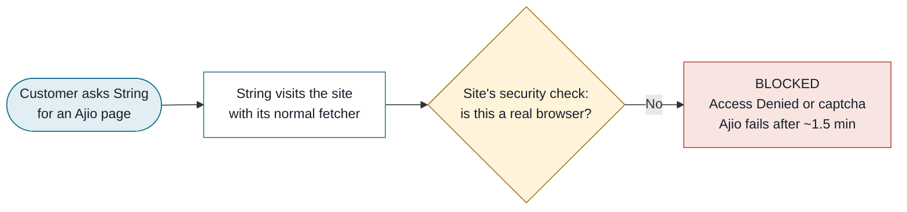
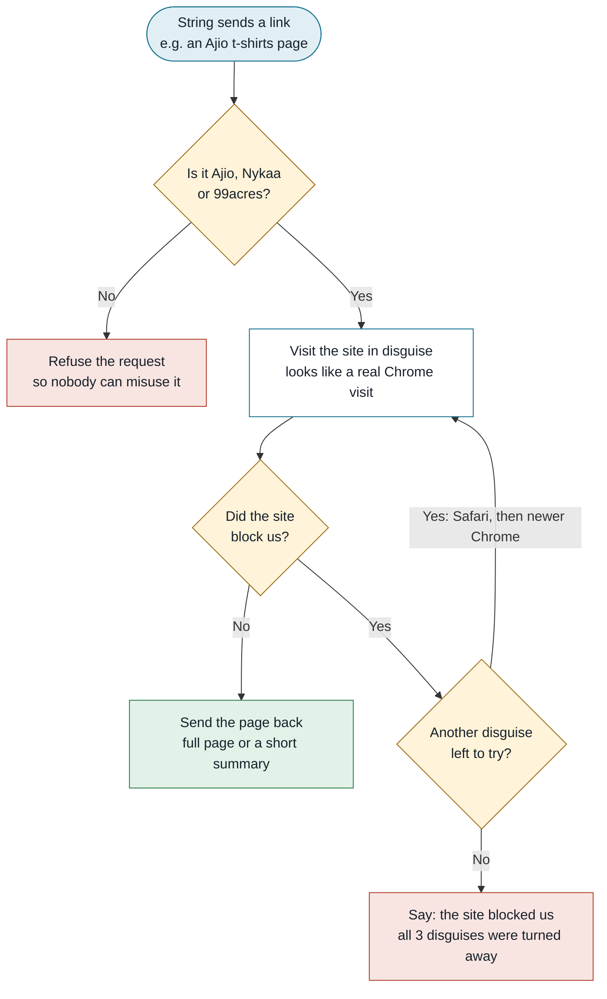
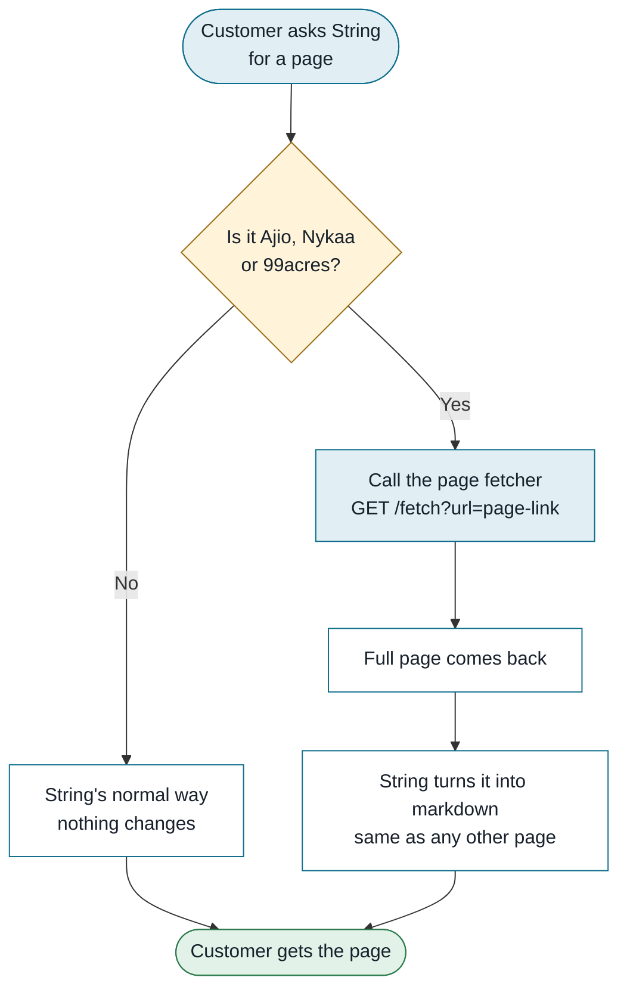
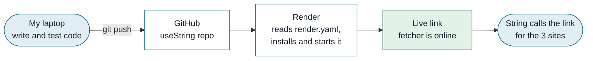

# Page Fetcher for String

Ajio, Nykaa and 99acres block String's fetcher because it doesn't look like a real browser.
This small service visits those pages looking exactly like Chrome or Safari, so the site lets it in and sends back the full page.

---

## 1. Where String fails today



**Why it gets caught:** these sites don't only check *what* you ask for, they check *how* you connect.
Every browser says "hello" to a website in its own way when the connection starts.
The security check reads that hello, sees it isn't a real browser, and shuts the door.
A plain Python request gets a `403 Forbidden` straight away.

---

## 2. How my fix works



| Before | After |
|---|---|
| String on its own is seen as a bot and gets "Access Denied" or a captcha. Ajio takes about 1.5 minutes just to fail. | String + page fetcher is seen as a normal Chrome or Safari shopper. The site sends the full page. |

---

## 3. How it plugs into String

String keeps working the same way. It adds one small rule: links from these 3 sites go to the page fetcher.



**Why send these 3 sites straight to the fetcher?** String's normal way will fail on them anyway, and on Ajio that takes about 1.5 minutes. Going straight to the fetcher skips the wait. As a safety net, String can also call the fetcher for any other site that comes back blocked.

The change on String's side (simplified):

```python
HARD_SITES = {"www.ajio.com", "www.nykaa.com", "www.99acres.com"}

if host in HARD_SITES:
    html = GET https://<fetcher-link>/fetch?url=<page link>
    return to_markdown(html)
# add &format=json to also get status, page title, size and time taken
```

---

## 4. How it's set up on GitHub



| File | What it does |
|---|---|
| `app.py` | The page fetcher: checks the site, visits in disguise, retries, sends the page back. |
| `get_request_ids.py` | Proof of the problem: sends Ajio and Nykaa links through String's API and prints the request IDs of the failures. |
| `render.yaml` | Tells Render how to install and start the service (free plan, Singapore region). |
| `requirements.txt` | The 3 libraries: FastAPI (web server), Uvicorn (runs it), curl_cffi (the browser disguise). |

---

## My approach

1. **Proved the problem first.** Sent real Ajio and Nykaa links through String's API and saved each request ID, so String's team can look up the exact failed requests.
2. **Found the real cause.** The block isn't about the link or the page. The sites look at how the connection starts.
3. **Copied a real browser instead of fighting the check.** Used `curl_cffi`, which connects exactly like Chrome or Safari. No captcha solving.
4. **Added backups and safety.** Three disguises tried in order, a 30-second limit per try, a clear "blocked" answer when all fail, and only the 3 problem sites are allowed.
5. **Kept it small and easy to plug in.** One file, one web link. String calls it like any other website.
6. **Put it online.** Code on GitHub, running on Render.

---

## Run it yourself

```bash
pip install -r requirements.txt
uvicorn app:app --host 0.0.0.0 --port 8000
```

Then open:

```
http://localhost:8000/fetch?url=https://www.ajio.com/men-tshirts/c/830216014
http://localhost:8000/fetch?url=https://www.ajio.com/men-tshirts/c/830216014&format=json
```

**Good to know:** Render's free plan sleeps when idle, so the first call after a break is slow. For real customer traffic, String would run this on its own servers.
